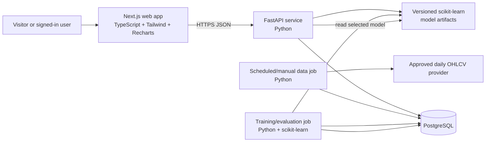
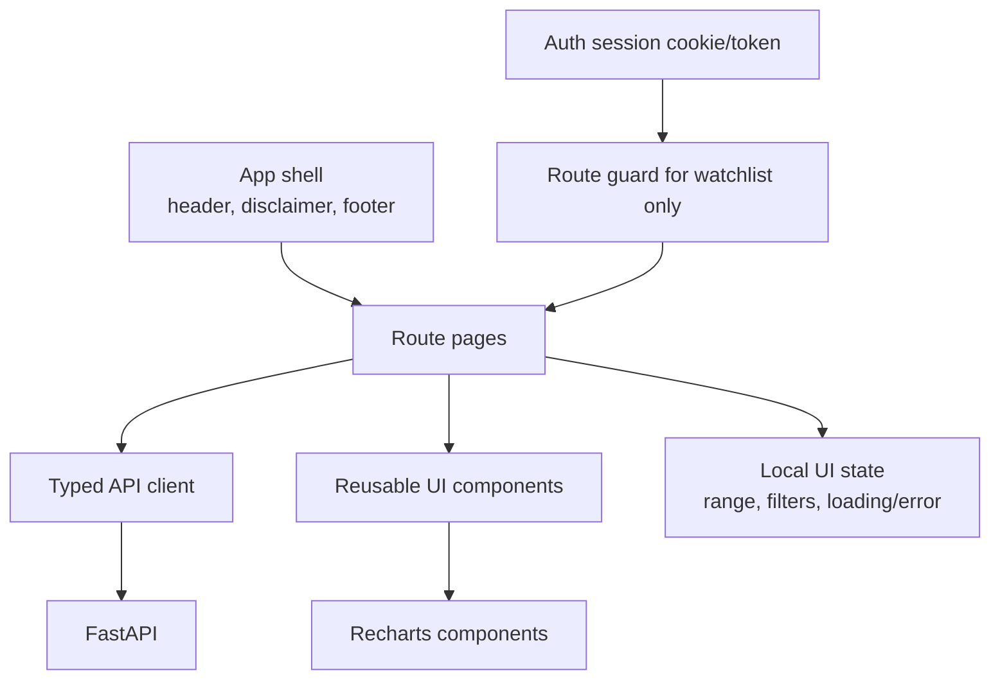
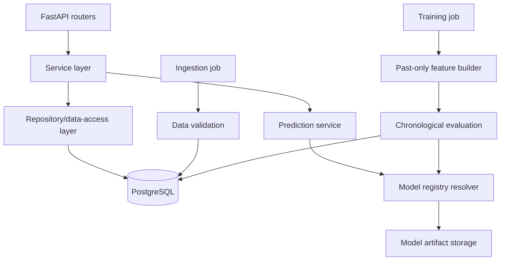
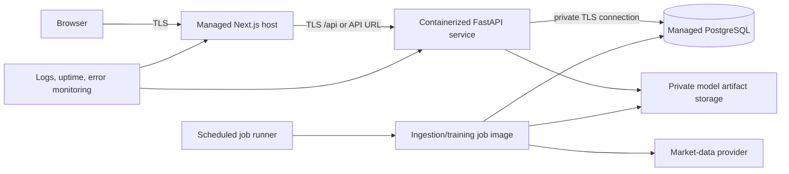
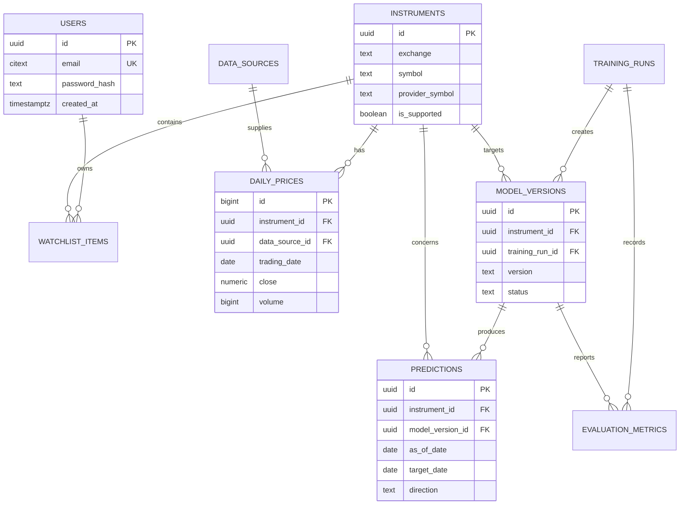

# StockSense AI — Project Design and Delivery Plan

**Status:** Approved-for-build design (no application code in this document)  
**Version:** 1.0  
**Project duration:** 30 days  
**Audience:** Student developer, evaluator, and demo audience  
**Primary market:** Indian equities listed on NSE or BSE  
**Prediction:** Whether a selected stock's *next trading session close* will be **UP** or **DOWN** versus its current-session close

---

## 1. Executive summary

StockSense AI is a small, honest web application for exploring daily Indian-stock price history and viewing a next-session direction prediction. A user selects a supported NSE/BSE stock, sees a price chart and recent prediction history, and requests a prediction for the next valid trading session.

The project deliberately frames the result as an educational model output, **not investment advice**. Its central success criterion is not a high-looking accuracy number: it is a reproducible, leakage-safe comparison of two simple classifiers against a majority-class baseline on a strictly future holdout period.

The minimum working product supports a curated set of liquid stocks, end-of-day data only, binary direction labels, one shared model per supported symbol (or a clearly documented pooled model only if per-symbol data is inadequate), and a basic account system for saving a watchlist. PostgreSQL is justified for user accounts, saved watchlists, reproducible data/model metadata, and prediction audit records. It is not required for numerical feature computation, which stays in Python.

### Product principles

1. **Truth before novelty.** Show test-period metrics, baseline results, confidence limitations, and data freshness.
2. **Daily data before real time.** The prediction is only as current as the latest completed and ingested trading session.
3. **Small scope, complete loop.** Data → validated features → trained model → saved artifact → API → understandable UI.
4. **No false precision.** A direction and calibrated/qualified model probability are useful; a target price, buy/sell signal, or profit promise is not.
5. **Reproducibility.** Every prediction identifies the data cutoff, feature version, model version, and evaluation run behind it.

---

## 2. Scope

### 2.1 In scope for the 30-day MVP

| Area | MVP commitment |
|---|---|
| Market and universe | Indian NSE/BSE equities; start with a curated 10–20 liquid, non-suspended large-cap symbols. Store exchange explicitly even when the data provider uses exchange-qualified tickers. |
| Market data | Daily OHLCV (open, high, low, close, adjusted close when available, volume) from one permitted provider, with provenance and ingestion timestamp. |
| Prediction | Next completed trading session's **close-to-close** direction: `UP` if next close > current close; otherwise `DOWN`. Ties are labelled `DOWN` and separately reported. |
| Features | Past-only technical and volume features: lagged returns, moving-average gaps, volatility, RSI-like momentum, volume ratio, weekday. No future data. |
| Models | Majority-class baseline, Logistic Regression, Random Forest. One selected challenger is published only after chronological validation. |
| Evaluation | Time-aware train/validation/test splits; fixed untouched final test period; accuracy plus balanced accuracy, precision, recall, F1, confusion matrix, and class distribution. |
| Frontend | Next.js + TypeScript + Tailwind CSS + Recharts. Public dashboard, stock detail, methodology/results, disclaimer; optional authenticated watchlist. |
| Backend | FastAPI + Python + scikit-learn. REST JSON API with OpenAPI documentation. |
| Persistence | PostgreSQL for relational, user, audit, and data-catalog records. Versioned model files remain in controlled application/object storage, referenced by database records. |
| Delivery | Local Docker-based development; one documented cloud deployment target; seeded demo dataset/model; polished README and 5–7 minute demo. |

### 2.2 Explicit exclusions

- No investment, tax, legal, or financial advice; no buying/selling recommendations.
- No intraday, live-tick, order-book, options, futures, crypto, forex, mutual fund, or portfolio optimization features.
- No price target or return forecasting; no claim that the model will be profitable.
- No automated trading, broker connectivity, notifications that instruct trades, or real-money functionality.
- No LLM/chatbot, news sentiment, social-media sentiment, web scraping of exchange pages, or paid proprietary feeds.
- No deep learning, reinforcement learning, neural networks, hyperparameter sweeps at scale, ensemble stacking, or AutoML.
- No support for every NSE/BSE security, corporate-action reconstruction, or guaranteed cross-exchange price matching.
- No mobile native app, multi-language UI, complex role-based administration, or public user-generated content.
- No misleading backtest charts that aggregate predictions made with future-trained models.

### 2.3 Definition of done

The project is done when a fresh evaluator can follow the README, run the documented local setup, browse seeded price/prediction results, understand the caveats, call documented endpoints, and verify that the published final-test model beats (or honestly does not beat) the majority baseline on the pre-declared metric. A model that fails to beat the baseline is still a valid finished result when reported transparently.

---

## 3. Users and primary journeys

### Personas

- **Curious student/investor:** wants to inspect one familiar stock and learn how a simple predictor behaves.
- **Project evaluator:** wants evidence that the system is engineered, safe, and evaluated correctly.
- **Project owner:** wants to rerun ingestion/training and understand what was deployed.

### Core journeys

1. A visitor opens the dashboard, reads the “educational only” notice, selects a stock, and sees latest available close, data-as-of date, next-session direction, and model/evaluation context.
2. A visitor opens a stock detail page, changes chart range, inspects price/volume and recent prediction outcomes, then follows the methodology link.
3. A registered user signs in and adds/removes supported stocks from a private watchlist.
4. An evaluator opens the methodology page and sees the label definition, split dates, baseline, final-test metrics, limitations, and data source.
5. The owner ingests a new completed session, validates the dataset, retrains only when scheduled/needed, and publishes a model only after recorded validation gates pass.

---

## 4. Architecture

### 4.1 Overall architecture



**Boundary:** the browser never accesses the database, provider API, model artifacts, or secrets. Training and ingestion are separate processes from request handling. They may run as manual commands in development and scheduled jobs in deployment; they are not FastAPI request endpoints.

### 4.2 Frontend architecture



Frontend responsibilities are presentation, accessible interaction, typed request/response handling, and clear empty/loading/error states. It does **not** compute model features, decide trading-session labels, store secrets, or invent financial claims.

### 4.3 Backend architecture



FastAPI handles validation, authorization, serialization, and business rules. The feature builder, trainer, and evaluator are importable Python modules invoked by jobs/commands, not duplicated inside HTTP handlers. Database repositories prevent route logic from containing raw SQL throughout the codebase.

### 4.4 Deployment architecture



Use separate environment variables and databases for development and production. In a student deployment, the scheduled runner can be a platform cron job calling the same container image with an explicit job command. Restrict artifact storage and database networking to backend/job identities only.

---

## 5. Data design and source caveats

### 5.1 Data contract

Each daily observation is uniquely identified by **(instrument, trading date, source)** and represents the source's final daily candle. Required values are date, open, high, low, close, and non-negative volume. `adjusted_close` is nullable because availability and adjustment conventions vary by source.

Before use, ingestion must reject or quarantine rows with invalid OHLC relationships (`low > high`, close outside low/high), negative prices/volume, duplicate keys, unparseable dates, non-monotonic historical series, or future-dated sessions. Missing dates are not automatically errors: holidays, exchange closures, and provider gaps must be differentiated.

### 5.2 Provider selection rules

Select one provider only after reviewing its terms, historical coverage, exchange/symbol naming, adjustment policy, rate limits, and permission to use data in a student web demo. A candidate may be an approved public API or downloadable dataset; the final README must name the exact provider, access date, and license/terms link.

Do not scrape NSE/BSE websites. Do not silently combine sources. If a provider changes vendor-normalized symbols, map them through the `instruments.provider_symbol` field and retain the raw source and ingest metadata.

### 5.3 Material caveats shown in the product

- Daily historical data may be delayed, incomplete, revised, or adjusted differently across providers.
- Exchange holidays and weekends mean “next session” is the next **available trading date**, not necessarily tomorrow.
- Corporate actions, symbol changes, suspensions, and delistings can distort raw historical prices. The MVP does not claim comprehensive adjustment handling.
- A close field is only as final as the source reports; latest-day predictions must display the exact data-as-of date.
- Historical validation is not evidence of future profitability. Directional accuracy can be near chance, and small test samples are noisy.
- NSE and BSE listings may differ in liquidity and identifiers; only symbols explicitly marked supported are available.

### 5.4 Data freshness policy

Ingest after the provider has published the completed daily bar, never during the session. Mark a prediction `stale` if its price data is more than two expected trading sessions old. When stale, preserve the last result but show a prominent unavailable/stale label rather than presenting it as current.

---

## 6. Leakage-safe machine-learning design

### 6.1 Target and timing contract

For stock *s* on completed session *t*:

`direction(t+1) = UP` when `close(t+1) > close(t)`; otherwise `DOWN`.

Features for the prediction made after close on *t* may use values known at or before the close of *t* only. The feature row is indexed by *t*, while its label comes from *t+1*. The final unlabelled row is eligible for a live next-session prediction but **never** for model evaluation.

The implementation must sort each instrument ascending by trading date before calculating lags/rolling windows. Rolling indicators use a trailing window ending at *t*, with `min_periods` equal to the full window unless a deliberately documented alternative is validated.

### 6.2 Candidate feature set (small and explainable)

| Feature | Definition at date *t* | Leakage guard |
|---|---|---|
| 1-day return | `close(t) / close(t-1) - 1` | Shifted historical close only |
| 5-day return | `close(t) / close(t-5) - 1` | Past five sessions only |
| MA gap 5/20 | `close(t) / SMA_5(t) - 1`; `SMA_5(t) / SMA_20(t) - 1` | Trailing windows end at t |
| 10-day volatility | Standard deviation of prior daily returns | Trailing returns only |
| Volume ratio | `volume(t) / mean(volume[t-19:t])` | Trailing volume only; protect zero denominator |
| Intraday range | `(high(t) - low(t)) / close(t)` | Same completed session only |
| Momentum oscillator | 14-session RSI-style calculation | Trailing gain/loss windows only |
| Weekday | Day of week of t | Calendar value known at t |

Do not add a feature merely because it is available later in the target session: future close, next-day high/low/volume, revised post-cutoff data, global normalization statistics, future technical indicators, or future labels are prohibited.

### 6.3 Feature and preprocessing rules

- Build features separately per instrument; no rolling window crosses a symbol boundary.
- Drop warm-up rows that lack full historical windows. Do not backfill them with future observations.
- Fit imputation, scaling, feature selection, and any class weighting decisions using training data only. Package preprocessing with the estimator in a scikit-learn `Pipeline`.
- Logistic Regression receives standardized numeric inputs fitted on training data only. Random Forest does not require scaling but uses the same split and input feature contract.
- Persist a feature-set version and ordered feature list with every training run. Predict only when the live row exactly matches that contract.
- Use a fixed random seed for repeatability; record it. This makes runs reproducible, not necessarily future-stable.

### 6.4 Chronological splits and model selection

For each supported stock, use data in date order. A recommended initial split is:

| Partition | Approximate share | Purpose |
|---|---:|---|
| Train | earliest 60% | Fit candidate pipelines |
| Validation | next 20% | Choose among pre-declared candidate settings/model type |
| Test | final 20% | One untouched, report-only final comparison |

Declare actual date boundaries in the model run record before inspecting final-test metrics. If the corpus is short, use expanding-window cross-validation **inside the pre-test period** for validation, then retain the last contiguous block as the only final test. Do not shuffle, use conventional random `train_test_split`, or let folds train on dates after their validation dates.

After selecting a model based on validation results, refit the selected pipeline on train + validation only, then score once on test. Optionally retrain the chosen model on all labelled history for production **only after** recording the untouched test results; production predictions must link to those evaluation results.

### 6.5 Baseline and candidates

| Model | Role | Guardrails |
|---|---|---|
| Majority-class baseline | Predicts the most common train label for every future row. Mandatory floor. | Determine class only from train partition; carry this exact rule into validation/test. |
| Logistic Regression | Primary simple, interpretable challenger. | `Pipeline` with training-only scaler; bounded pre-declared regularization options; fixed seed. |
| Random Forest | Nonlinear challenger. | Conservative pre-declared depth/tree settings; fixed seed; no giant blind parameter search. |

Select the model with the best validation **balanced accuracy**, using F1 and stability as tie-breakers. It is acceptable—and important—to publish the baseline if neither model gives a meaningful, stable validation improvement. “Meaningful” should be written before test scoring, for example a positive validation balanced-accuracy lift with no class recall collapsing; do not tune that rule after seeing test scores.

### 6.6 Evaluation and reporting

Report each partition's row count, date range, UP/DOWN counts, and the following on validation and final test: accuracy, balanced accuracy, precision, recall, F1 (state positive label), confusion matrix, baseline comparison, and 95% confidence interval where feasible (e.g., nonparametric bootstrap, clearly labeled as approximate). Avoid ROC-AUC as the headline if class predictions—not a carefully calibrated ranking—are the product.

The UI must show the final-test period and sample count next to any headline metric. It must not show training accuracy as product quality. Prediction probabilities are model scores, not probabilities of profit; only display them if calibration/reliability is assessed on validation data, otherwise use low/medium/high *model confidence* with an explicit non-financial wording.

### 6.7 Training and publication gates

1. Ingestion completes and validation report contains no blocking errors.
2. Feature build reports the expected feature names, no future dates, and no train/validation/test overlap.
3. Baseline and both candidate models evaluate on the same chronological rows.
4. Selected model and rationale are recorded before final-test scoring.
5. Final-test results, data cutoff, code/config revision, seed, and artifact checksum are stored.
6. A model is marked `published` only if artifacts load successfully and its evaluation record is complete; otherwise retain the last valid published version or show no prediction.

---

## 7. PostgreSQL data model

### 7.1 Schema overview



### 7.2 Tables, constraints, and indexes

Use UUID primary keys except `daily_prices.id`, which may be `bigint` identity for high-volume sequential writes. Store all timestamps as `timestamptz` in UTC. Currency is INR for the MVP but do not infer it from exchange alone; record it on the instrument.

| Table | Essential columns | Constraints | Indexes |
|---|---|---|---|
| `users` | `id`, `email`, `password_hash`, `created_at`, `updated_at`, `is_active` | `email` case-insensitive unique; valid nonempty bcrypt/Argon2 hash; timestamps required | unique `email`; `is_active` partial/standard index only if admin queries require it |
| `instruments` | `id`, `exchange`, `symbol`, `provider_symbol`, `display_name`, `currency`, `is_supported`, `created_at` | `exchange IN ('NSE','BSE')`; uppercase trimmed symbols; unique `(exchange, symbol)`; currency `IN ('INR')` for MVP | unique `(exchange, symbol)`; partial `(is_supported, exchange, symbol)` where supported |
| `data_sources` | `id`, `name`, `base_url`, `terms_url`, `timezone`, `is_active`, `created_at` | unique `name`; required terms URL; timezone expected `Asia/Kolkata` | unique `name` |
| `daily_prices` | `id`, `instrument_id`, `data_source_id`, `trading_date`, OHLC, `adjusted_close`, `volume`, `source_published_at`, `ingested_at`, `raw_hash` | unique `(instrument_id, data_source_id, trading_date)`; all OHLC > 0; `low <= high`; `open/close BETWEEN low AND high`; volume >= 0; no future `trading_date` at insertion/job validation | unique natural key; `(instrument_id, trading_date DESC)`; `(data_source_id, trading_date DESC)` |
| `ingestion_runs` | `id`, `data_source_id`, `started_at`, `finished_at`, `status`, `requested_through_date`, counts, `error_summary` | status enum/check `RUNNING/SUCCEEDED/FAILED/PARTIAL`; finish after start when present | `(data_source_id, started_at DESC)`; partial `status` for non-success runs |
| `training_runs` | `id`, `started_at`, `finished_at`, `status`, `data_cutoff_date`, `feature_set_version`, `config_json`, `git_revision`, `random_seed`, `error_summary` | required immutable config and cutoff on success; status check | `(status, started_at DESC)`; `(data_cutoff_date DESC)` |
| `model_versions` | `id`, `instrument_id`, `training_run_id`, `version`, `algorithm`, `artifact_uri`, `artifact_sha256`, `status`, `published_at`, `created_at` | unique `(instrument_id, version)`; algorithm limited to `MAJORITY_BASELINE/LOGISTIC_REGRESSION/RANDOM_FOREST`; status `CANDIDATE/PUBLISHED/RETIRED/FAILED`; checksum 64 hex chars; one published model per instrument enforced by partial unique index | unique partial `instrument_id WHERE status='PUBLISHED'`; `(instrument_id, status)` |
| `evaluation_metrics` | `id`, `training_run_id`, `model_version_id`, `partition`, date boundaries, sample/class counts, metric columns, `confusion_matrix_json`, `created_at` | unique `(model_version_id, partition)`; partition `TRAIN/VALIDATION/TEST`; metrics in [0,1] when present; test boundaries required for `TEST` | `(model_version_id, partition)`; `(training_run_id)` |
| `predictions` | `id`, `instrument_id`, `model_version_id`, `as_of_date`, `target_date`, `direction`, `score`, `data_cutoff_date`, `created_at`, `outcome_direction`, `outcome_recorded_at` | unique `(instrument_id, model_version_id, as_of_date)`; direction/outcome `UP/DOWN`; target date > as-of date; score [0,1] nullable; outcome only after target session | `(instrument_id, target_date DESC)`; `(model_version_id, as_of_date DESC)`; partial unresolved predictions |
| `watchlist_items` | `user_id`, `instrument_id`, `created_at` | composite PK/unique `(user_id, instrument_id)`; foreign keys cascade only when deleting user, restrict deletion of instruments in use | `(user_id, created_at DESC)` |

### 7.3 Database rules

- Use foreign keys for every relationship shown. Use `ON DELETE RESTRICT` for historic financial/model records so accidental deletion cannot orphan audit data.
- Application migrations own the schema; no `create_all` behavior in production.
- JSON is appropriate for immutable training configuration and confusion matrices, but query-critical values (dates, metrics, status) remain typed columns.
- Store password hashes only; never store reset tokens or sessions unencrypted in a permanent table unless authentication design requires it.
- A database `CHECK` cannot reliably validate exchange calendars or prevent every future date across timezones; job-level validation is still mandatory.

---

## 8. API contract

### 8.1 Common conventions

- Base prefix: `/api/v1`; JSON request and response bodies; ISO 8601 dates/timestamps.
- Pagination: `limit` (default 50, max 200) and opaque `cursor` for list endpoints. Never expose database offsets as a public contract.
- Public data endpoints are read-only and rate limited by IP. Authentication endpoints are additionally rate limited by account/IP.
- Protected endpoints use a short-lived access token or secure HTTP-only session cookie. For a student MVP, HTTP-only `Secure`, `SameSite=Lax` cookie sessions are the simplest browser-safe choice; add CSRF protection for unsafe cookie-authenticated requests.
- Errors use a stable envelope: `{ "error": { "code", "message", "details", "request_id" } }`. Do not return traces, secrets, hashes, or provider responses.
- FastAPI/Pydantic validates types and formats; service rules validate supported symbols, ownership, staleness, and business constraints.

### 8.2 Public endpoints

| Method & path | Purpose | Request validation | Success response | Principal errors |
|---|---|---|---|---|
| `GET /health` | Liveness/readiness summary | no body | service status, database/model readiness, version | `503 SERVICE_UNAVAILABLE` if dependencies fail |
| `GET /instruments` | List supported stocks | optional exchange `NSE/BSE`, bounded search, pagination | instruments with display data and freshness status | `400 VALIDATION_ERROR` |
| `GET /instruments/{exchange}/{symbol}` | Instrument profile | exchange enum; symbol uppercase valid pattern and supported | instrument, latest-data date, source attribution | `404 INSTRUMENT_NOT_FOUND` |
| `GET /instruments/{exchange}/{symbol}/prices` | Daily price/chart rows | `from`, `to` valid dates; range ≤ 5 years; max 1,500 rows | OHLCV rows, source, timezone, data-as-of | `400 VALIDATION_ERROR`, `404`, `422 DATA_UNAVAILABLE` |
| `GET /instruments/{exchange}/{symbol}/prediction/latest` | Latest published prediction | supported instrument | direction, optional score/confidence wording, as-of/target date, stale flag, model/evaluation summary, disclaimer | `404 PREDICTION_NOT_AVAILABLE`, `409 DATA_STALE` when policy blocks serving |
| `GET /instruments/{exchange}/{symbol}/predictions` | Historical predictions/outcomes | bounded date range/pagination | predictions with known outcome when available | `400`, `404` |
| `GET /methodology` | Published methods and current metrics | no body | target definition, features, model metadata, split/test results, caveats | `503` only if required published record absent |

Example `GET /instruments/NSE/RELIANCE/prediction/latest` success shape:

```json
{
  "instrument": {"exchange": "NSE", "symbol": "RELIANCE", "display_name": "Reliance Industries Ltd."},
  "prediction": {
    "direction": "UP",
    "as_of_date": "2026-10-22",
    "target_date": "2026-10-23",
    "data_cutoff_date": "2026-10-22",
    "stale": false,
    "model_version": "reliance-v1",
    "model_label": "Logistic Regression",
    "score": 0.56
  },
  "evaluation": {"partition": "TEST", "from": "2025-08-01", "to": "2026-01-31", "samples": 125, "balanced_accuracy": 0.52, "baseline_balanced_accuracy": 0.50},
  "notice": "Educational model output only; not investment advice."
}
```

The dates and metrics above are illustrative contract values, not performance claims.

### 8.3 Authentication and watchlist endpoints

| Method & path | Auth | Request validation | Success | Expected errors |
|---|---|---|---|---|
| `POST /auth/register` | none | normalized valid email; password length ≥ 12; block common passwords | `201` user-safe profile/session | `409 EMAIL_ALREADY_EXISTS`, `422 VALIDATION_ERROR`, `429 RATE_LIMITED` |
| `POST /auth/login` | none | email/password required | `200` safe profile/session | `401 INVALID_CREDENTIALS`, `429` |
| `POST /auth/logout` | session | CSRF token if cookie auth | `204` | `401 UNAUTHENTICATED` |
| `GET /me` | session | none | safe user profile | `401` |
| `GET /me/watchlist` | session | pagination | current user's watchlist | `401` |
| `POST /me/watchlist` | session | exchange/symbol must be supported; max 20 entries | `201` saved item | `400 WATCHLIST_LIMIT_REACHED`, `401`, `404`, `409 WATCHLIST_ITEM_EXISTS` |
| `DELETE /me/watchlist/{exchange}/{symbol}` | session | owned item | `204` | `401`, `404 WATCHLIST_ITEM_NOT_FOUND` |

The API never returns `password_hash`, raw provider credentials, internal artifact URI, stack traces, or another user's watchlist. Admin/job operations are deliberately not exposed publicly in MVP; they run through authenticated deployment tooling.

---

## 9. UI/UX specification

### Global experience

Desktop-first but responsive. Use a calm neutral palette with clear semantic colors: green/red direction badges must always be paired with the words **UP**/**DOWN** and must not be the only signal. Every page has a concise fixed-position or prominent disclaimer link: “Educational only — not investment advice.” Use Indian date formatting consistently and label all prices as INR where applicable.

| Page | Purpose and content | Key states/interactions |
|---|---|---|
| `/` Dashboard | Hero sentence explaining scope; searchable supported-stock selector; 6–10 popular stock cards; latest data-as-of banner; methodology/disclaimer links. | Skeleton on load; source unavailable state; search returns “supported stocks only”; card opens detail. |
| `/stocks/[exchange]/[symbol]` Stock detail | Title/exchange; prominent current prediction card (direction, target date, as-of, stale state); price range controls; Recharts close/volume chart; recent prediction outcome table; evaluation mini-card; source attribution. | 1M/3M/1Y/Max ranges; chart tooltip accessible via table alternative; empty prediction explains why; stale state suppresses fresh-looking prediction. |
| `/methodology` | Plain-language target definition; data source; leakage safeguards; split timeline; baseline vs models metric table; limitations; glossary. | Metrics show dates/sample size; nontechnical callouts explain “why this is not advice.” |
| `/disclaimer` | Full educational/data/caveat statement, contact/project ownership. | Static, printable, linked from footer. |
| `/login`, `/register` | Minimal account forms for watchlist. | Inline validation; generic login failure; loading lockout prevention; no prediction gating. |
| `/watchlist` | Authenticated list of up to 20 saved instruments with latest direction/data freshness. | Empty-state link to dashboard; remove confirmation; requires auth; preserves list after refresh. |
| `/not-found` and error UI | Friendly bad-link/server failure page with retry and home link. | Never expose internal details. |

### Stock detail information hierarchy

1. Symbol, exchange, supported status, and last available data date.
2. Direction badge and **target session**, with educational disclaimer beside it.
3. “How well did this model do?” test-period score + sample count + baseline comparison.
4. Price chart and recent predictions; then detailed methods/source caveats.

Avoid “Buy,” “Sell,” “Strong signal,” “expected gain,” or profit-oriented copy. A score of 0.56 must never be styled as certainty. If no model or data is available, lead with that state rather than rendering placeholder accuracy.

### Accessibility and quality bar

- Keyboard-operable search, tabs/range controls, auth forms, and watchlist actions; visible focus states.
- Semantic headings, form labels, descriptive buttons, sufficient contrast, and chart data table/summary fallback.
- Mobile layout stacks metric cards and places chart controls above charts; no hover-only information.
- Loading skeletons mirror final layout. Error messages explain the next action (“Try again,” “choose another supported stock”).

---

## 10. Proposed repository structure

This is a professional **target structure**, not application code. Keep frontend and backend independently testable and keep data/model artifacts out of Git.

```text
stocksense-ai/
├── README.md
├── docs/
│   ├── STOCKSENSE_AI_DESIGN.md
│   ├── api-contract.md
│   ├── data-dictionary.md
│   └── demo-script.md
├── frontend/
│   ├── src/
│   │   ├── app/                 # Next.js routes/layouts
│   │   ├── components/          # shared UI and chart components
│   │   ├── features/            # stock, prediction, watchlist features
│   │   ├── lib/                 # typed API client and utilities
│   │   ├── types/               # API/UI TypeScript types
│   │   └── styles/
│   ├── public/
│   └── tests/
├── backend/
│   ├── app/
│   │   ├── api/                 # FastAPI routers/dependencies
│   │   ├── core/                # config, logging, security
│   │   ├── db/                  # sessions, repositories, migrations hooks
│   │   ├── models/              # ORM entities
│   │   ├── schemas/             # Pydantic request/response schemas
│   │   ├── services/            # domain services
│   │   └── ml/                  # features, training, evaluation, inference
│   ├── jobs/                    # ingestion/retraining entry points
│   ├── tests/
│   │   ├── unit/
│   │   ├── integration/
│   │   └── fixtures/
│   └── alembic/                 # versioned database migrations
├── infra/
│   ├── docker/
│   └── deployment/              # deployment manifests/templates, no secrets
├── scripts/                     # local developer-only orchestration
├── .github/workflows/           # CI checks
├── .env.example
└── .gitignore                   # excludes .env, raw data, model artifacts
```

Raw provider downloads, database dumps, trained model binaries, credentials, and large generated charts do not enter Git. Store reproducibility metadata (configuration, hashes, date ranges, metrics) in the database and/or small versioned manifest files instead.

---

## 11. Security, privacy, and reliability

### Security baseline

- Enforce HTTPS in production; set secure headers and a narrow CORS allowlist for the deployed frontend origin.
- Keep secrets in the deployment secret manager/environment, never in Git, browser bundles, logs, exception messages, or `.env.example` values.
- Hash passwords with Argon2id or bcrypt using maintained settings; compare safely; issue secure, HTTP-only, SameSite cookies or short-lived tokens. Add CSRF protection for cookie-authenticated unsafe requests.
- Validate and normalize all API input; enforce server-side watchlist limits and instrument allowlists. Parameterize database queries via ORM/query layer.
- Rate limit login/registration and public endpoints. Return generic login failures to avoid account enumeration.
- Use least-privilege database identities: app read/write identity, migration identity, and optionally job identity. Do not expose PostgreSQL to the internet.
- Pin dependencies where practical, scan for known vulnerabilities in CI, and retain minimal structured logs with request IDs.
- Do not log passwords, session tokens, provider keys, raw authorization headers, or sensitive personal data.

### Reliability and operational safeguards

- Health check includes only safe dependency status, not credentials or internal topology.
- Run database backups and test a restoration procedure before the demo if a hosted database is used.
- Ingestion is idempotent: re-running a date does not create duplicate daily prices; conflicts are audited rather than silently overwritten.
- Model publication is atomic: serve either the old complete model or the new complete model, never a partly written artifact.
- If database, model, or data freshness requirements fail, degrade to a clear unavailable state; never fabricate a prediction.

---

## 12. Test strategy

| Layer | What to test | Examples |
|---|---|---|
| Unit — frontend | Rendering and interaction logic | direction/stale badges, metric formatting, range selection, inaccessible/error states |
| Unit — backend | Deterministic business/validation functions | ticker normalization, date-range limits, ownership checks, error mapping |
| Unit — ML | Leakage and feature invariants | no feature uses future row; per-symbol rolling reset; final live row has no label; scaler fit on train only; split dates do not overlap |
| Integration | API + test PostgreSQL | register/login, watchlist ownership, supported symbol listing, price range, prediction response/error shapes |
| Integration — data | ingestion idempotency/validation | duplicates rejected/upserted by rule, invalid OHLC quarantined, source/date provenance retained |
| Contract | Frontend/API compatibility | generated/checked OpenAPI schema; examples match typed client |
| End-to-end | Essential browser journeys | public stock view, methodology page, authenticated watchlist, stale/no-prediction state |
| Manual acceptance | Trust and usability | disclaimer visible, test period/sample count beside metric, keyboard navigation, mobile layout, no buy/sell wording |

Minimum CI gate: formatting/linting, TypeScript check, backend tests, frontend unit tests, API integration tests against disposable PostgreSQL, and a small leakage regression test with synthetic chronological data. Training on a full provider dataset can be a scheduled/manual validation job rather than a CI prerequisite.

### ML-specific acceptance tests

1. A synthetic later-price change cannot alter any earlier feature row.
2. Every train date is earlier than every validation date; every validation date is earlier than every test date.
3. The baseline class is derived from training labels, not global labels.
4. Scaling/imputation are fitted exclusively on train data and serialized with Logistic Regression.
5. Test metrics cannot be written until a selected-model decision has been recorded.
6. A prediction response traces to an existing published model and its test evaluation record.

---

## 13. 30-day delivery schedule

Assume one focused student work session daily. Commit messages use conventional, descriptive wording. Do not proceed past a checkpoint with hidden leakage or an unavailable data source.

| Day | Work | Tangible outcome | Suggested commit |
|---:|---|---|---|
| 1 | Confirm project charter, target label, exclusions, and success criteria. | Signed-off one-page scope. | `docs: define StockSense MVP scope and exclusions` |
| 2 | Compare legal/technical suitability of 2–3 daily Indian-equity sources; select one and document terms. | Provider decision and caveat note. | `docs: record market data source decision` |
| 3 | Finalize this design, architecture, API boundaries, and UI map. | Versioned source-of-truth plan. | `docs: add complete StockSense design` |
| 4 | Create repository, issue board, branch rules, README skeleton, and environment template. | Clean project scaffold with no secrets. | `chore: initialize project structure and tooling` |
| 5 | Configure frontend/backend quality tools and a basic CI workflow. | CI runs formatting/type/test placeholders. | `ci: add baseline quality checks` |
| 6 | Create PostgreSQL schema/migration plan and local database environment. | Migration applies to empty database. | `db: add initial relational schema` |
| 7 | Build instrument catalog and supported-universe seed process. | 10–20 verified symbols recorded. | `data: seed supported instrument catalog` |
| 8 | Implement provider adapter design and raw ingestion path. | One symbol's daily data ingested with provenance. | `feat: add daily price ingestion adapter` |
| 9 | Add data validation, idempotency, and ingestion-run records. | Invalid/duplicate fixture tests pass. | `feat: validate and audit daily price ingestion` |
| 10 | Backfill selected universe and inspect missingness/outliers. | Data-quality report and approved usable date range. | `data: backfill curated stock universe` |
| 11 | Define label/feature module and synthetic time-series fixtures. | Written feature contract and fixtures. | `ml: define past-only feature contract` |
| 12 | Implement lag/rolling features with strict per-symbol ordering. | Feature table with warm-up rows dropped. | `feat: build leakage-safe technical features` |
| 13 | Add leakage regression tests and chronological split utility. | Split/invariant tests pass. | `test: guard against time-series leakage` |
| 14 | Implement majority-class baseline and evaluation report. | Baseline validation metrics artifact. | `ml: add chronological majority baseline` |
| 15 | Implement Logistic Regression pipeline with train-only preprocessing. | Reproducible validation result. | `ml: add logistic regression challenger` |
| 16 | Implement conservative Random Forest candidate. | Comparable validation result. | `ml: add random forest challenger` |
| 17 | Select model by pre-declared validation rule; record rationale. | Model-selection record; no final test yet. | `docs: record validation model selection` |
| 18 | Run untouched chronological final test and save metrics/confusion matrix. | Honest final evaluation report. | `ml: publish final holdout evaluation` |
| 19 | Add model registry/artifact checksum and prediction audit persistence. | Loadable candidate/published model workflow. | `feat: add model registry and prediction audit trail` |
| 20 | Implement FastAPI public read endpoints and OpenAPI descriptions. | Health, instruments, prices, latest prediction endpoints tested. | `feat: expose public market data API` |
| 21 | Implement authentication and private watchlist endpoints. | Ownership/limit/error tests pass. | `feat: add secure watchlist API` |
| 22 | Create app shell, dashboard, responsive navigation, disclaimer. | Polished static frontend routes. | `feat: build dashboard shell and disclosures` |
| 23 | Build stock detail data states, metric card, and accessible Recharts visualization. | Real API-backed stock page. | `feat: add stock detail and price chart` |
| 24 | Build methodology, disclaimer, login, and watchlist screens. | Full user journey works locally. | `feat: add methodology and watchlist pages` |
| 25 | Add frontend typed API integration, loading/empty/error/stale states. | No misleading placeholder data. | `feat: handle API and stale-data states` |
| 26 | Expand unit/integration/E2E tests; run accessibility pass. | Test report and prioritized fixes. | `test: cover critical user and API flows` |
| 27 | Containerize services; configure production variables, CORS, health checks, and migration procedure. | Deployment-ready staging configuration. | `infra: prepare container deployment configuration` |
| 28 | Deploy staging, configure scheduled ingestion, and perform smoke/recovery checks. | Working hosted staging URL or documented blocker. | `deploy: release StockSense staging environment` |
| 29 | Finish README, data/model cards, screenshots, demo script, and resume bullets. | Evaluator-ready documentation package. | `docs: complete demo and project documentation` |
| 30 | Rehearse demo, fix highest-impact defects, tag release, and archive evidence. | Final demo build and release checklist. | `release: finalize StockSense AI MVP` |

### Checkpoints

- **End of Day 3 — Design gate:** scope, provider decision path, and no-code design approved.
- **End of Day 10 — Data gate:** sufficient clean historical daily data for selected universe; otherwise reduce symbols or revise source before ML work.
- **End of Day 18 — Evaluation gate:** leakage tests pass and untouched final test is reported against baseline. Do not hide an unsuccessful model.
- **End of Day 25 — Product gate:** public dashboard/detail/methodology work end-to-end; no data/model should be represented as current when stale.
- **End of Day 30 — Demo gate:** clean setup, deployed or reproducible local demo, docs, and screenshot/video evidence complete.

---

## 14. Deployment plan

### Environments

| Environment | Purpose | Data/model policy |
|---|---|---|
| Local | Daily development and tests | Synthetic fixtures or limited permitted data; local PostgreSQL; no real secrets committed. |
| Staging | Integration/demo rehearsal | Separate database, restricted secrets, seeded supported universe, clearly marked non-production. |
| Production/demo | Public evaluator access | Managed PostgreSQL, HTTPS frontend/API, private model artifacts, scheduled completed-session ingestion. |

### Release sequence

1. Run automated checks and database migrations in staging.
2. Confirm `/health`, public list/price endpoints, and a prediction trace from model record to UI.
3. Verify CORS, secure cookies/auth, environment-specific URLs, and that no development error pages or secrets are exposed.
4. Seed only supported symbols and publish only a model with a complete recorded evaluation.
5. Promote immutable application image/revision; run migrations before traffic if backward-compatible, otherwise use a documented maintenance plan.
6. After deploy, smoke test dashboard, stock detail, methodology, login/watchlist, stale/unavailable state, and scheduled job logs.

### Operational runbook (MVP)

- **Daily:** inspect ingestion-run status and row-count anomaly; do not train automatically unless the project has a tested scheduled retraining policy.
- **Weekly or after material new data:** retrain using the same leakage-safe pipeline, record a new run, and publish only through the gates in §6.7.
- **Provider failure:** mark freshness as stale, retain historical charts with attribution, and return/display clear prediction unavailability.
- **Bad deployment:** roll back application image; do not delete model/evaluation history. Restore database only from tested backups and record the incident.

---

## 15. Final deliverables

### README checklist

- One-paragraph project purpose and prominent educational/no-advice statement.
- Screenshot/GIF and deployed URL (if available).
- Supported market/universe, exact label definition, data source and caveats.
- Technology overview and architecture link.
- Local prerequisites, environment variables by name only, setup/run/test commands, and migration steps.
- Evaluation protocol, baseline comparison, actual final-test metrics/date range/sample count, and limitations.
- API/OpenAPI link, security notes, deployment approach, and troubleshooting.
- Clear statement of what is deliberately out of scope.

### Demo package (5–7 minutes)

1. Open the dashboard; state the scope and educational disclaimer (30 seconds).
2. Select a supported NSE/BSE stock; explain data-as-of and next-session date (60 seconds).
3. Read the prediction card without calling it a recommendation; show chart and recent outcomes (90 seconds).
4. Open methodology; explain past-only features, chronological split, baseline, and final-test sample size (90 seconds).
5. Sign in and add/remove a private watchlist item (60 seconds).
6. Show API docs/health and briefly explain ingestion/model audit trail (60 seconds).
7. Close with limitations and one next-step idea, e.g. a more robust provider or walk-forward monitoring—not feature inflation (30 seconds).

### Resume-ready bullets (adapt only after actual completion)

- Built StockSense AI, a full-stack educational dashboard for next-session UP/DOWN classification on a curated universe of Indian NSE/BSE equities using Next.js, FastAPI, scikit-learn, and PostgreSQL.
- Designed a leakage-safe, chronological ML evaluation pipeline comparing Logistic Regression and Random Forest against a majority-class baseline; reported final holdout metrics with model/data provenance.
- Delivered typed REST APIs, accessible financial visualizations, secure private watchlists, ingestion validation, and reproducible deployment documentation.

### Evidence to preserve

- Final architecture/design document, provider terms snapshot/link, data-quality report, and model card.
- Baseline/candidate evaluation outputs with date partitions and confusion matrices.
- Test/CI results, deployment checklist, screenshots, demo recording, and final release tag.

---

## 16. Decision log and open implementation decisions

| Decision | Initial choice | Rationale / action before coding |
|---|---|---|
| Task framing | Classification of close-to-close direction | Small, interpretable, testable 30-day scope. |
| Market scope | Curated liquid NSE/BSE stocks | Avoids unsupported, illiquid, or symbol-mapping complexity. |
| Data frequency | Completed daily bars only | Eliminates intraday timing and streaming scope. |
| Database | PostgreSQL | Justified for accounts, watchlists, audit history, metadata, and daily data querying. |
| Model set | Baseline + LR + RF | Adequate educational comparison without overengineering. |
| Model selection | Validation balanced accuracy; untouched test once | Reduces misleading accuracy and test-set tuning. |
| Authentication | Optional, only for watchlist | Keeps core learning product public and reduces critical path. |
| Provider | EODHD free personal tier for private/local student development | One year of daily history and 20 calls/day are sufficient for the starter MVP. It must not be used to publicly display/redistribute raw prices without an appropriate licence; see `DATA_SOURCE_DECISION.md`. |
| Serving granularity | Per-symbol preferred | Confirm adequate history/class balance; use pooled model only with a clearly redesigned evaluation and UI explanation. |
| Hosting vendor | **To be selected by Day 27** | Choose a student-appropriate option that supports Next.js, containerized FastAPI, managed PostgreSQL, secrets, and scheduled jobs. |

Any decision that changes the target, uses future information, adds a non-daily data source, or introduces trade recommendations requires an explicit revision to this document and a new evaluation plan before implementation.

---

## 17. Final acceptance checklist

- [ ] Scope/exclusions remain unchanged or documented through decision-log update.
- [ ] Provider terms and freshness/adjustment caveats are published.
- [ ] Every feature is demonstrably available by the as-of close; leakage tests pass.
- [ ] Validation and final test are strictly chronological and non-overlapping.
- [ ] Majority baseline, Logistic Regression, and Random Forest are compared on identical partitions.
- [ ] Final test is scored once after model selection and shown honestly, even if baseline wins.
- [ ] Every served prediction traces to a published model, data cutoff, and final evaluation record.
- [ ] UI labels data currency, test period/sample size, and educational disclaimer clearly.
- [ ] API input/auth/error behavior matches the documented contract and automated tests.
- [ ] Secrets/artifacts/raw data are excluded from version control; deployment uses HTTPS and managed secrets.
- [ ] README, demo script, screenshots, evidence, and final release are complete.

This document is the project source of truth until revised. When implementation begins, changes should be made through a dated decision-log entry and, where relevant, a new leakage/evaluation review—not quietly introduced in code.
